# VoiceNote

**A personal AI agent you talk to, running on hardware you own.**

You hold a button and talk. A GPU speech model on your own machine
transcribes you in a fraction of a second. Then an agent goes to work:
- it **sees** your photos and videos;
- **researches** the web and cites what it read;
- **runs code** on its own Linux computer;
- **writes** full documents with diagrams;
- **keeps** your lists and goals;
- **checks in** on a schedule;
- **learns** the way you like things done.

The app is a native Android client. Everything behind it runs on your own GPU
box: local models, transcription, the agent and its sandbox. Your notes, your
data and your keys never have to leave home.

<table>
  <tr>
    <td>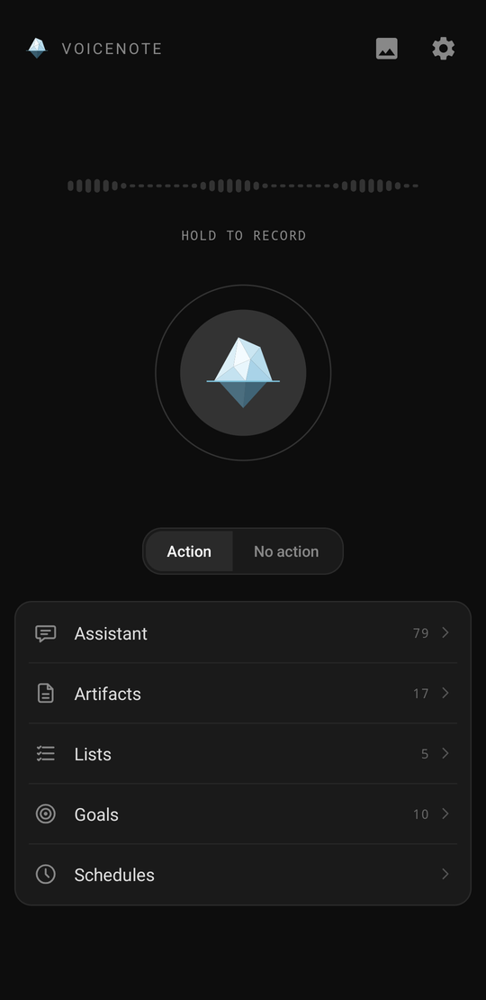</td>
    <td>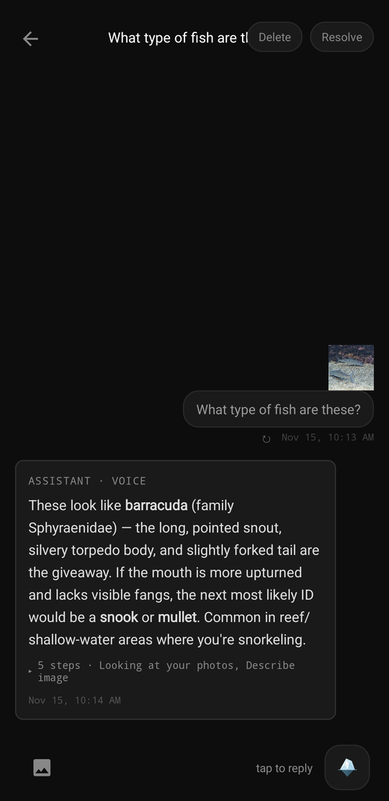</td>
    <td>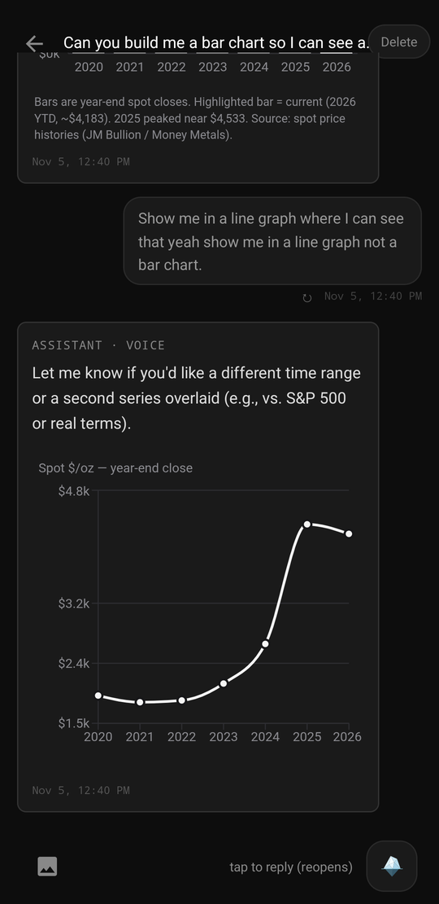</td>
    <td>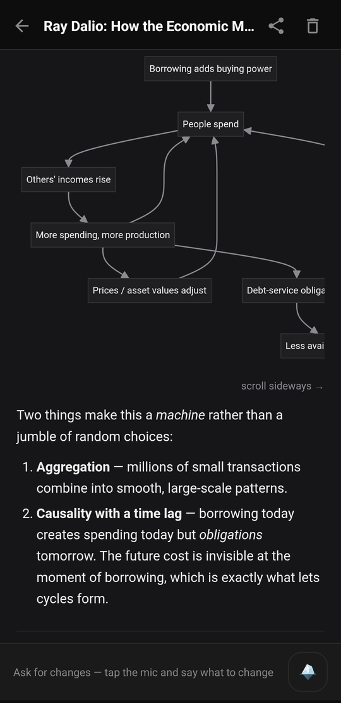</td>
  </tr>
</table>

## What it can do

### Talk, don't type
- **Recording:** hold to record from the app or a home-screen widget.
- **Transcription:** **Parakeet**, an NVIDIA NeMo model, runs on your GPU and
  takes about 0.2 s for a short note. A faster-whisper fallback covers it if
  Parakeet is down, and on-device recognition is available too.
- **Threads:** every conversation is a thread, and a voice follow-up
  continues it. Flip to *No action* to journal a thought without a reply.
- **Never lost:** notes recorded offline queue up and send when you're back,
  and replies land exactly once, even across flaky connections.

### It sees what you see
- **Photos:** attach photos and ask anything. It reads receipts, signs and
  whiteboards, identifies things, and answers visual questions.
- **Videos:** attach a phone video (up to 5 min) and the agent *watches* it.
  - Inside its sandbox it finds the scene cuts and the stretches with motion.
  - It looks over a contact sheet, then zooms in on the moments that matter.
  - It answers with timestamps, e.g. "the red box appears at 00:12".

  The recipes document below was built from a one-minute video of a pantry.

### Answers you can look at
- **Charts in replies:** numbers come back as live charts, tables and
  dashboards rendered in the thread, not walls of text.
- **Reshape by voice:** say "show that as a line graph instead" and it
  redraws.

### Research that cites its sources and picks up where it left off
- **Web research:** searches the web and reads the pages, in a real headless
  browser when it needs one.
- **Sources:** every page it read is recorded and linked: search results,
  pages it fetched, and pages it browsed in its sandbox.
- **Checkpoints:** long investigations save their progress. If one pauses,
  a one-tap **Continue** card resumes it exactly where it stopped.

### Documents, not chat bubbles
- **Reader:** long answers become **documents** in a full-screen reader with
  a library: rendered markdown, **diagrams** (Mermaid), **math** (KaTeX),
  tables and numbered citations.
- **Edit by voice:** *Ask for changes* by voice from inside the reader, and
  the agent **revises the same document in place**. You get a version bar,
  word-level **change highlighting** you can step through, and one tap back
  to the previous version.
- **Share:** as a print-quality PDF, as a formatted Gmail email, or as a
  file.

### Its own computer, with a safety net
- **The machine:** the agent drives a persistent Linux sandbox (Python, Node,
  Playwright/Chromium, ffmpeg, OpenCV) to actually *do* the work: write and
  run code, scrape, convert, analyse, verify.
- **Run folders:** each task gets its own folder with a goal, a plan and
  checkpoints, so long jobs survive interruptions.
- **Smart approvals:** a small local "System One" model ([Kev](https://github.com/jaredpalmer/kev))
  screens every command, including scripts the agent wrote that turn. It
  holds only the suspicious ones for your approval, with the reason. If the
  checker is down, it fails closed. Manual and fully-automatic modes too.

### It learns how you work (self-written skills)
When a conversation settles on something reusable, the agent drafts it as an
entry in your **learned wiki**: a report format, a multi-step procedure you
refined together, a standing preference.
- **Approval first:** it shows the entry as an approval card, and nothing is
  saved until you approve it.
- **Amendments:** next time it applies the entry, and if you tweak the
  result it proposes an **amendment as a diff**, not a duplicate.
- **History:** entries are plain markdown in a git-backed folder, so every
  approved change has history and rollback.
- **Over time:** the assistant builds a library of skills written in your
  words, and stops re-asking what it already learned.

### Proactive, on a schedule
- **Scheduled runs:** run any prompt on a cron schedule on the server, such
  as a 5 a.m. surf report, a morning list check or a Sunday review. The
  result arrives as a thread.
- **Proposed schedules:** the agent can *propose* a schedule mid-chat. It
  only takes effect when you tap Approve.
- **Nightly goal mining:** every night it reads your recent notes, pulls out
  goals you keep talking about, attaches new context and drafts plans.
- **Location and SMS:** arriving at a saved place (e.g. "you're near the
  store…") and an SMS sweep can each open a thread on their own.

### Lists, goals and notes
- **Lists:** "Add garlic and ginger to groceries" edits your lists. You can
  also edit them by hand.
- **Goals:** each has a statement, mined context, notes and a multi-step plan
  you can approve, edit as markdown, or ask about by voice.
- **Notes:** every transcript is kept and searchable.

### Any model, your hardware
- **One picker, three back-ends:** **Ollama** (local; the default, with
  vision), **vLLM** (a fast local 27B text model) and **OpenRouter** (370
  hosted models, from OpenAI, Anthropic, Google, Qwen, DeepSeek, Mistral and
  others). It's grouped endpoint › maker › model, with search.
- **Automatic routing:** turns a model can't handle go to one that can.
  Images and video go to a vision model, and a conversation too long for
  vLLM's context window moves to Ollama.
- **Agent builder:** a web **admin UI** composes agents, attaches skills and
  edits skill text, live, with no restart. A built-in `/diag` dashboard
  traces every turn and tool call in real time.

### Private by design
- **Self-hosted:** everything runs on your machine, reachable from your phone
  over your private network (e.g. Tailscale).
- **Keys:** API keys stay on the server, and cloud models and search are
  optional.
- **Your data:** your lists, notes and documents live on your phone and your
  box.

## Screenshots

<table>
  <tr>
    <td align="center">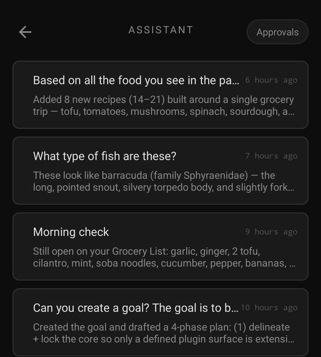<br><sub>Threads: answers, check-ins, goals</sub></td>
    <td align="center">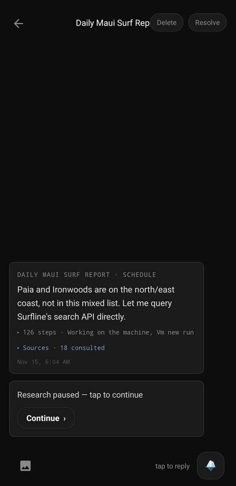<br><sub>A scheduled research run: 126 steps, 18 sources, one-tap Continue</sub></td>
    <td align="center">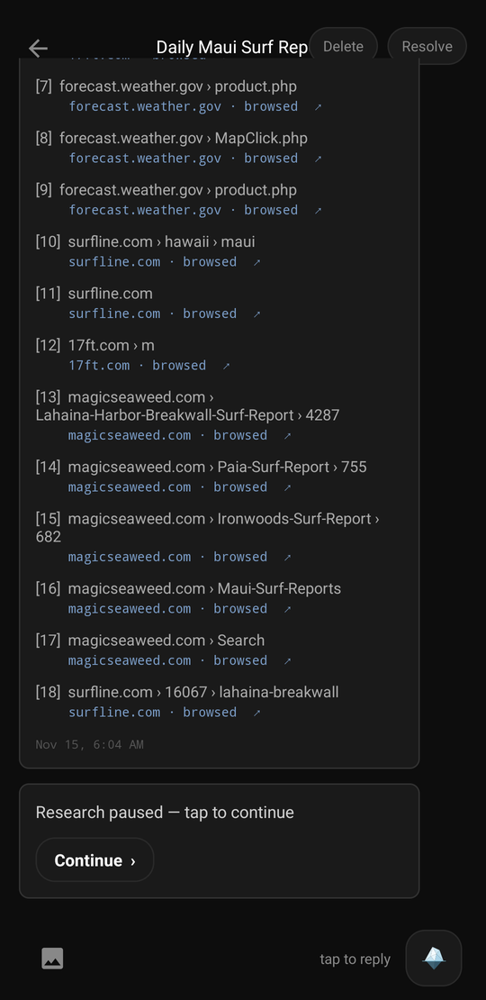<br><sub>Every page it read, linked</sub></td>
  </tr>
  <tr>
    <td align="center">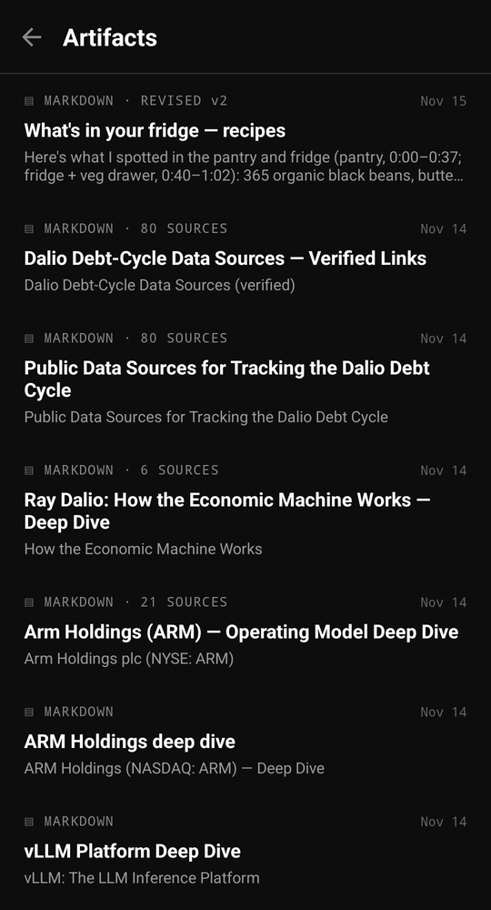<br><sub>The document library</sub></td>
    <td align="center">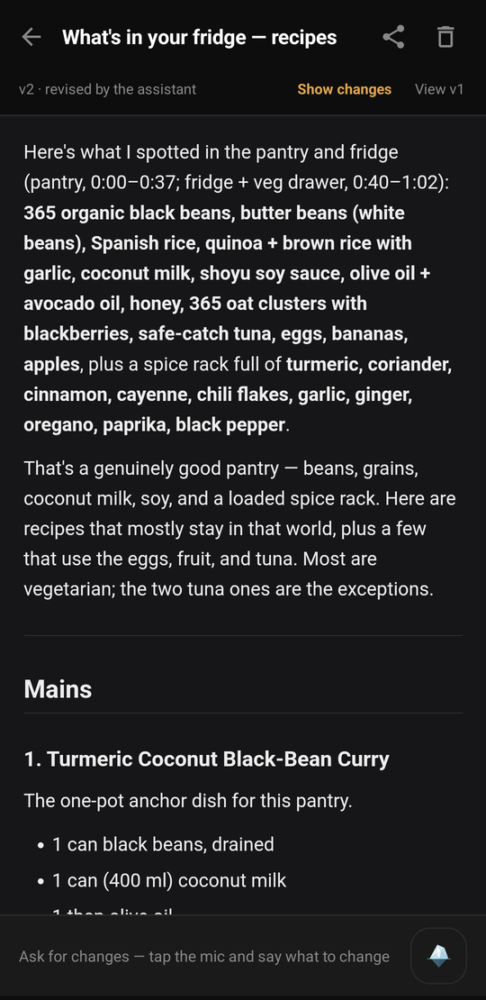<br><sub>A document built from a pantry video, revised to v2</sub></td>
    <td align="center">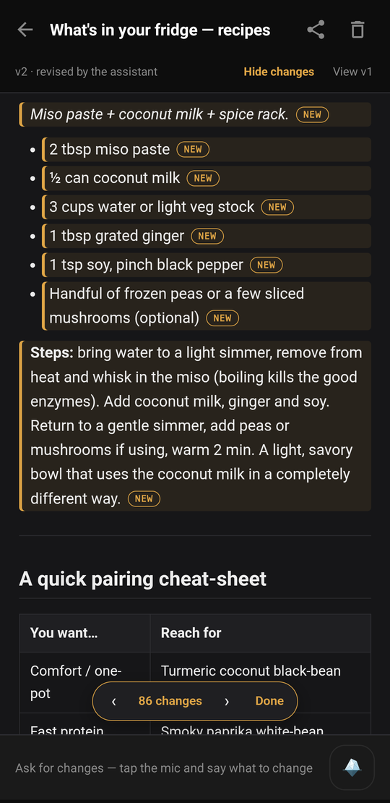<br><sub>Change highlighting after a voice-requested revision</sub></td>
  </tr>
  <tr>
    <td align="center">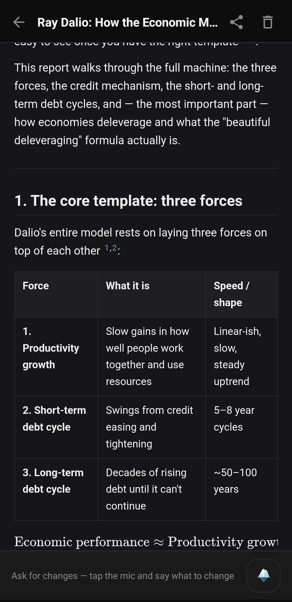<br><sub>Tables, citations and math in the reader</sub></td>
    <td align="center">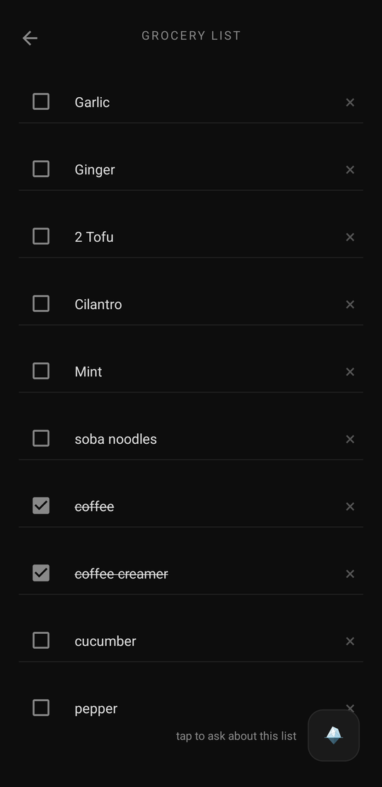<br><sub>Lists the assistant keeps</sub></td>
    <td align="center">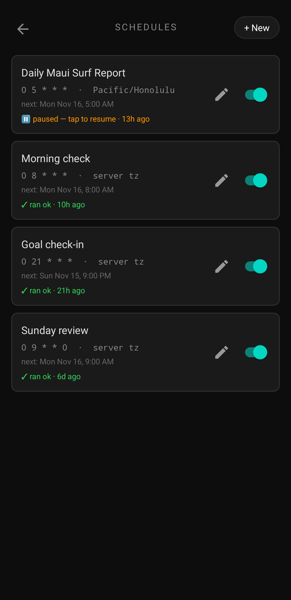<br><sub>Server-side schedules with run status</sub></td>
  </tr>
  <tr>
    <td align="center">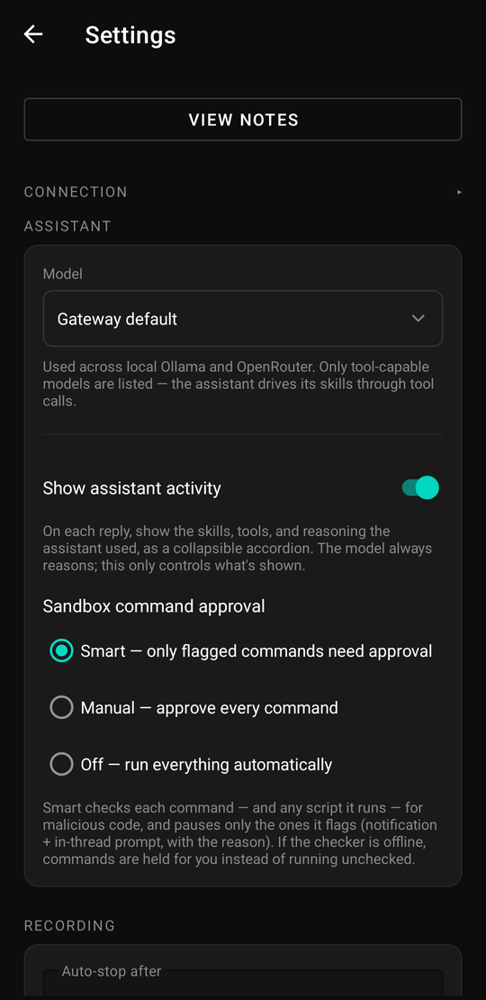<br><sub>Smart / manual / off sandbox approvals</sub></td>
    <td align="center">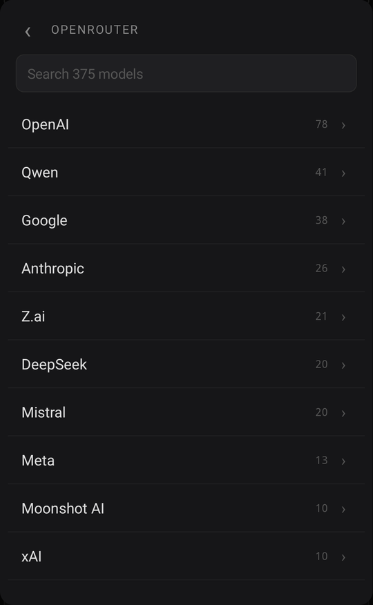<br><sub>375 models, grouped endpoint › maker › model</sub></td>
    <td></td>
  </tr>
</table>

## How it fits together

```
 Android app (VoiceNote)
   │  your private network (e.g. Tailscale)
   ├──:10301 ─ asr/      whisper-api router ─▶ parakeet-api (GPU)  ─╮ speech → text
   │                                         └▶ faster-whisper (CPU) ╯ fallback
   └──:5001 ── gateway/  agent-gateway (FastAPI, Docker)
                  ├─▶ Ollama   :11434  local models (default; has vision)   [host, systemd]
                  ├─▶ vLLM     :8000   fast local text model (optional)     [host, systemd]
                  ├─▶ Kev      :8009   typed decisions → smart approvals (optional) [host, systemd]
                  ├─▶ OpenRouter / Tavily (cloud, optional keys)
                  └─▶ vmm-daemon :5002 ─▶ sandbox container (the agent's Linux box) [Docker]
```

| Folder | What it is |
|---|---|
| [`android/`](android/) | The Android app (Kotlin, Room, WorkManager). |
| [`gateway/`](gateway/) | agent-gateway (FastAPI) plus `vmm/`, the sandbox daemon and image. |
| [`asr/`](asr/) | Transcription stack: Parakeet (NVIDIA NeMo, GPU), a faster-whisper fallback, and the router. |
| [`setup/`](setup/) | The setup scripts, systemd unit templates, and the health check. |

Deeper docs:
- [`gateway/RUNBOOK.md`](gateway/RUNBOOK.md): operating every service day to day, plus troubleshooting.
- [`gateway/docs/ARCHITECTURE.md`](gateway/docs/ARCHITECTURE.md): how the code works.
- [`gateway/AGENTS.md`](gateway/AGENTS.md): guidance for working on the gateway.
- [`gateway/vmm/README.md`](gateway/vmm/README.md): the sandbox.

---

## Requirements

- **OS:** Linux with **systemd**. Either Ubuntu 22.04/24.04, or **WSL2 Ubuntu
  on Windows 11** with `[boot] systemd=true` in `/etc/wsl.conf`.
- **GPU:** an **NVIDIA GPU** and a working driver (`nvidia-smi` works).
  - Ollama's default model plus Parakeet need about 24 GB of VRAM.
  - Adding Kev (+20 GB) and vLLM (+44 GB) needs a 96 GB-class card. Both are
    optional.
- **Docker** with GPU access:
  - Windows: **Docker Desktop** with WSL integration on.
  - Native Linux: docker-ce plus the NVIDIA Container Toolkit.
  - Compose v2 either way.
- **Disk:** about 60 GB for images and models, more with vLLM.
- **Network:** a way for the phone to reach the box on ports **5001** and
  **10301**. Tailscale on both is easiest. On WSL, install the *Windows*
  Tailscale app; Docker Desktop publishes the ports on Windows.
- **For the app:** Android Studio, or JDK 17 and the Android SDK, and an
  Android 8.0+ phone.

## Quick start

```bash
git clone <this repo> voicenote && cd voicenote
```

**1. Host services** (Ollama, plus optional Kev and vLLM, as systemd units;
uses sudo):

```bash
bash setup/01-host.sh --with-kev        # add --with-vllm on a big GPU
```

**2. Containers** (gateway, sandbox and transcription; prints the app settings
at the end):

```bash
bash setup/02-services.sh
```

**3. Check everything:**

```bash
bash setup/healthcheck.sh
```

**4. Build and install the app** (from `android/`):

```bash
cd android && ./gradlew :app:assembleDebug        # Windows: gradlew.bat :app:assembleDebug
```

```bash
adb install -r app/build/outputs/apk/debug/app-debug.apk
```

The first build needs the Android SDK: either open the folder once in Android
Studio, or create `android/local.properties` with `sdk.dir=/path/to/Android/Sdk`.

**5. In the app → Settings,** enter what `02-services.sh` printed:
- **Gateway URL:** `http://<your-pc>:5001`.
- **Gateway API key:** generated into `gateway/.env`.
- **Transcription endpoint:** `http://<your-pc>:10301/v1/audio`.

Then pick an assistant model; the picker is grouped endpoint › maker › model.
Record a note, and the reply arrives in the thread.

### What the scripts do

**`setup/01-host.sh`** runs as you and uses sudo where needed:
1. Checks prerequisites, and installs `uv`.
2. Installs **Ollama**. A systemd drop-in sets `OLLAMA_HOST=0.0.0.0`, so
   containers can reach it, plus keep-alive and parallel settings.
3. Pulls `DEFAULT_MODEL` (`qwen3.8:latest`).
4. With `--with-kev`: clones `jaredpalmer/kev` into `~/kev`, builds its venv
   (torch cu128 plus the pinned `flash-linear-attention`), writes
   `~/.config/kev/kev.env` with a random bearer key, and installs and starts
   `kev.service` on :8009.
5. With `--with-vllm`: builds `~/vllm-venv-cu128` (vllm 0.24.0, cu128, and the
   prebuilt FlashInfer kernels), then installs and starts `vllm.service` on
   :8000. It serves `nvidia/Qwen3.8-27B-NVFP4`, text only, with a 128k context.

**`setup/02-services.sh`:**
1. Creates `gateway/.env` from `.env.example` (mode 600) and generates
   `GATEWAY_API_KEY`.
2. Copies Kev's key in, or falls back to *manual* sandbox approvals if Kev
   isn't installed.
3. Optionally asks for OpenRouter and Tavily keys.
4. Builds the sandbox image `vmm-sandbox:base` (about 15 min the first time).
5. Starts the gateway and vmm: `docker compose up -d --build` in `gateway/`.
6. Starts transcription the same way in `asr/`. The first Parakeet start
   downloads about 2.5 GB.
7. Waits for health, then prints the app settings.

Both scripts are **idempotent**: re-run them after pulling changes.

## Configuration

Everything lives in **`gateway/.env`**; see
[`gateway/.env.example`](gateway/.env.example) for every key, with comments.

| Key | Required | Purpose |
|---|---|---|
| `GATEWAY_API_KEY` | recommended | Bearer token for the app and other clients |
| `DEFAULT_MODEL` | yes (default set) | Ollama model; must support vision for images and video |
| `OPENROUTER_API_KEY` | optional | Hosted models (Anthropic, OpenAI, etc.) in the model picker |
| `TAVILY_API_KEY` | optional | Web search for the agent |
| `KEV_API_KEY` | with Kev | Must match `~/.config/kev/kev.env` |
| `VMM_APPROVAL_MODE` | yes (default set) | `smart` needs Kev; otherwise `manual` or `auto` |
| `VLLM_BASE_URL` / `VLLM_MODEL` | with vLLM | Defaults match `01-host.sh` |

After editing `.env`, run `cd gateway && docker compose up -d`.

## Day-to-day

| Task | Command |
|---|---|
| Status of everything | `bash setup/healthcheck.sh` |
| Gateway logs / restart | `docker logs -f agent-gateway` / `docker restart agent-gateway` |
| Live traces | `http://<your-pc>:5001/diag` (keep it on your private network) |
| Agent and skill registry UI | `http://<your-pc>:5001/admin` |
| Free GPU memory | `sudo systemctl stop vllm` (turns fall back to Ollama) |
| Rebuild the sandbox after editing `gateway/vmm/profiles/base.pkgs` | `bash gateway/vmm/build_image.sh base && bash gateway/vmm/migrate_shared_box.sh` |
| Rebuild transcription | `cd asr && docker compose up -d --build` |

**Back up:**
- `gateway/state/`: the SQLite DB, uploaded media and the wiki;
- the `vmm-ws-shared` Docker volume: the sandbox's `/workspace`.

Neither is in git.

## What's *not* in this repo

The following are left out on purpose; the setup scripts recreate or download
them:
- **Secrets:** `.env`, `kev.env`, `local.properties` and signing keys.
- **Runtime state:** `gateway/state/`, sandbox keys and images, `asr/data/`.
- **Model weights.**
- **Network-specific details:** hostnames and device IDs. Docs use
  placeholders like `<your-pc>`.
